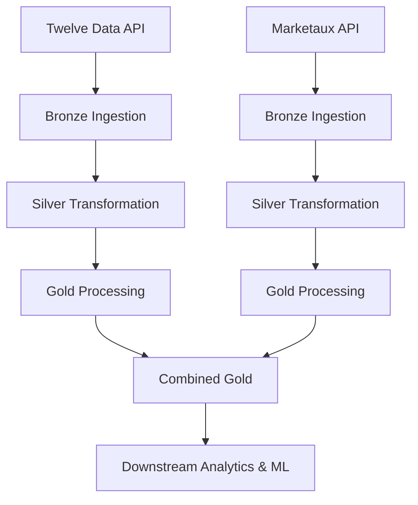

# Market Data Pipeline

An automated, cloud-deployed market data engineering pipeline that collects, processes, validates, and consolidates financial market data from multiple external providers.

Built with Python, Polars, Parquet, DuckDB, and AWS, the project implements a Bronze–Silver–Gold architecture to transform raw financial data into structured datasets for downstream analytics and machine learning.

## Overview

The pipeline integrates two primary data sources:

- **Twelve Data** – Historical and recent stock market data.
- **Marketaux** – Financial news and sentiment data.

Collected data passes through a multi-stage processing architecture, with each stage responsible for ingestion, transformation, validation, and consolidation.

The resulting datasets are designed to support quantitative analysis, feature engineering, and downstream machine learning applications.

## Architecture

The project follows a Medallion-style data architecture:



### Bronze – Raw Data Ingestion

Responsible for retrieving data from external APIs and preserving the original responses for downstream processing.

Key responsibilities:

- API communication and response handling.
- Incremental ingestion and historical backfilling.
- Rate limiting and API quota management.
- Ingestion state tracking.
- Raw data persistence in Parquet and JSON formats.
- Handling unsuccessful requests and incomplete responses.

### Silver – Data Transformation

Transforms raw source data into structured, standardized datasets.

Key responsibilities:

- Data cleaning and normalization.
- Schema enforcement and validation.
- Duplicate handling.
- Data type standardization.
- Transformation into analytical Parquet datasets.

### Gold – Analytical Data Processing

Produces consolidated datasets suitable for downstream consumption.

Key responsibilities:

- Aggregation and analytical transformations.
- Stock market indicator calculations.
- Financial news sentiment aggregation.
- Integration of market and news datasets.
- Validation of final analytical outputs.

The combined Gold layer produces market features by joining stock price data with financial news sentiment information.

## Data Sources

| Provider    | Data                     | Purpose                                    |
| ----------- | ------------------------ | ------------------------------------------ |
| Twelve Data | Stock market time series | Historical prices and technical indicators |
| Marketaux   | Financial news           | News coverage and sentiment analysis       |

### Market Data

Stock market data is processed into structured datasets containing price information and calculated indicators, including:

- Open, high, low, and close prices.
- Trading volume.
- Daily percentage changes.
- Simple moving averages.
- Relative Strength Index (RSI).

### Financial News and Sentiment

Financial news data is collected and transformed into ticker-level analytical records.

The processing includes:

- Article ingestion and deduplication.
- Sentiment score extraction.
- Ticker-level aggregation.
- Bullish, neutral, and bearish classification.
- Daily sentiment metrics.

## Technology Stack

| Component            | Technology                   |
| -------------------- | ---------------------------- |
| Programming Language | Python                       |
| Data Processing      | Polars, NumPy                |
| Storage Format       | Apache Parquet, JSON         |
| Analytical Database  | DuckDB                       |
| Cloud Infrastructure | AWS                          |
| Containerization     | Docker                       |
| Container Registry   | Amazon ECR                   |
| Compute              | AWS Lambda                   |
| Object Storage       | Amazon S3                    |
| Scheduling           | Amazon EventBridge Scheduler |
| Notifications        | Amazon SNS                   |
| Quota Management     | Amazon DynamoDB              |
| Testing              | pytest                       |
| Version Control      | Git                          |

## Cloud Deployment

The pipeline is deployed on AWS using a containerized Lambda architecture.

Deployment components:

- **AWS Lambda** – Executes the complete market data pipeline.
- **Amazon ECR** – Stores versioned Docker images.
- **Amazon S3** – Stores pipeline data and generated outputs.
- **Amazon EventBridge Scheduler** – Triggers automated executions.
- **Amazon SNS** – Delivers execution status notifications.
- **Amazon DynamoDB** – Supports API quota tracking and management.

The current schedule is configured to execute twice daily:

- 8:30 AM Singapore time.
- 8:30 PM Singapore time.

Each execution runs the provider pipelines and subsequently performs the combined Gold processing stage.

Execution reports include pipeline status, individual provider results, and execution duration.

## Engineering Considerations

The project incorporates several production-oriented engineering practices:

- **Incremental ingestion:** Avoids repeatedly retrieving data that has already been collected.
- **Historical backfilling:** Extends dataset coverage while maintaining ingestion progress.
- **API quota management:** Tracks provider usage and enforces request budgets.
- **Rate limiting:** Controls request frequency to respect external API restrictions.
- **Data validation:** Checks output schemas and data integrity across processing stages.
- **Idempotent processing:** Supports repeated executions without unnecessarily duplicating analytical records.
- **Failure handling:** Captures provider and stage-level failures for execution reporting.
- **Concurrency management:** Coordinates parallel provider execution and serialized database writes.
- **Automated testing:** Uses unit and integration tests to validate pipeline behaviour.

## Testing

The project includes automated tests covering:

- API client behaviour.
- Bronze ingestion and state management.
- Silver transformations.
- Gold aggregations and validation.
- Pipeline orchestration.
- Error handling and recovery.
- Data persistence and idempotency.
- Lambda execution behaviour.

The latest recorded test suite completed with **928 passing tests**.

## Project Structure

```text
market-data-pipeline/
│
├── configs/                 # Provider configurations and schemas
├── src/
│   └── market_data/
│       ├── api/             # External API clients
│       ├── pipelines/
│       │   ├── twelvedata/  # Stock market data pipeline
│       │   ├── marketaux/   # Financial news pipeline
│       │   └── main.py      # Pipeline orchestration
│       ├── lambda_handler.py
│       └── ...
│
├── tests/                   # Unit and integration tests
├── pyproject.toml
├── Dockerfile
└── README.md
```

## Future Development

This repository focuses on market data collection, transformation, and storage.

A separate downstream machine learning project is planned to consume the processed datasets and explore:

- Feature engineering.
- Predictive modelling.
- Market regime analysis.
- Financial time-series forecasting.
- News sentiment integration.
- Strategy backtesting and evaluation.

Keeping data engineering and machine learning in separate projects allows the ingestion infrastructure to operate independently of model development.

## Author

Developed as a personal data engineering project to build a scalable and automated market data infrastructure for quantitative research and machine learning.

**GitHub:** [Scarl3tx](https://github.com/Scarl3tx)
